# LoL Companion

Appli de bureau, compagnon de **League of Legends** : elle lit ton compte directement dans le client lancé sur ton PC
(sans clé API, sans Internet) pour suivre ton niveau et ta progression, ta session de jeu, tes stats par champion, ta
maîtrise, tes missions, et te dire si tu es prêt pour la classée.

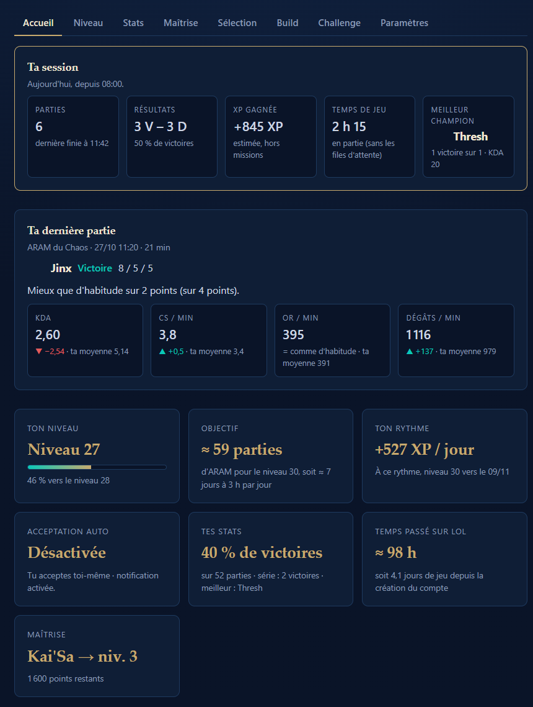

*Captures faites avec un compte fictif et un faux client League (les icônes des champions sont remplacées par des
lettres ; avec le vrai client, ce sont les icônes du jeu). Le build de l'onglet Build vient des vraies statistiques
publiques (Lolalytics, OP.GG).*

## Les onglets

| Onglet | Ce qu'il montre |
|---|---|
| **Accueil** | Le bilan de ta session en grand, puis une carte par onglet (niveau, objectif, rythme, classée, stats, missions, maîtrise, acceptation auto). Chaque carte ouvre l'onglet détaillé |
| **Niveau** | Le calculateur : parties, heures et jours restants avant ton niveau visé pour 4 modes, et ta courbe de progression |
| **Classée** | Checklist niveau 30 + 20 champions, ton Essence bleue et les champions que tu peux acheter tout de suite |
| **Missions** | Tes missions en cours et l'XP de compte qu'elles rapportent |
| **Stats** | Taux de victoire et KDA par champion et par mode, meilleurs champions, moments où tu gagnes le plus, sur 30 jours ou depuis le début |
| **Maîtrise** | Les champions les plus proches du niveau de maîtrise suivant, tes plus joués, la liste complète |
| **Sélection** | Conseiller de draft : les 5 meilleurs champions pour la draft en cours, avec la raison (matchups, synergies). Pick et ban automatiques (désactivés par défaut) : 3 champions et 3 bans dans l'ordre, par rôle |
| **Build** | Build de ton champion d'après les statistiques de Lolalytics et d'OP.GG (3 choix par emplacement avec taux de victoire et de sélection, runes, sorts), page de runes et set d'objets créés automatiquement, consultation du build de n'importe quel champion ; en jeu : stats des augments (ARAM Mayhem) et alerte avant les objectifs (Faille) |
| **Paramètres** | Acceptation automatique, session et pauses, arrière-plan, dossier du jeu, effacement des historiques |

<details>
<summary><strong>Voir une capture de chaque onglet</strong></summary>

### Niveau
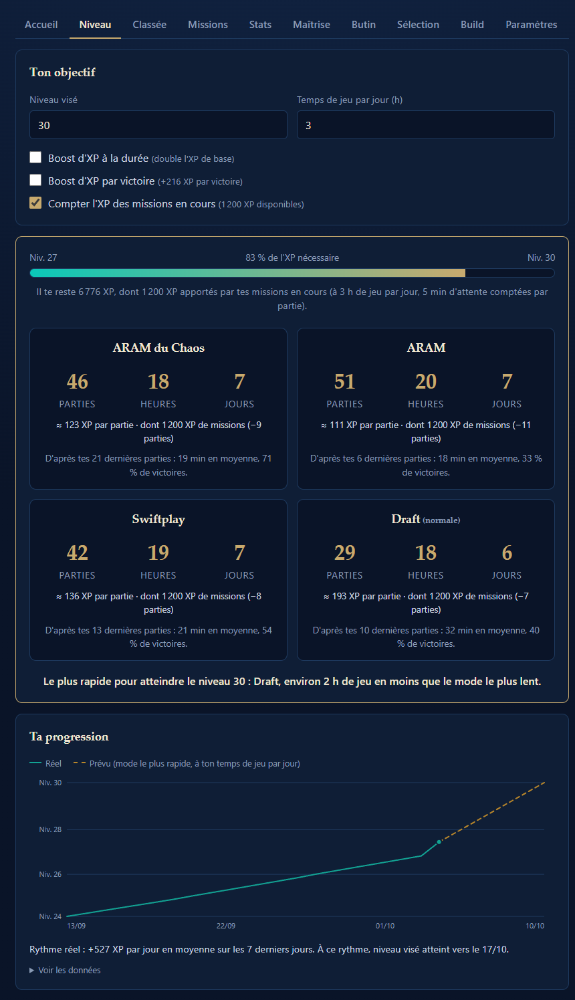

### Classée
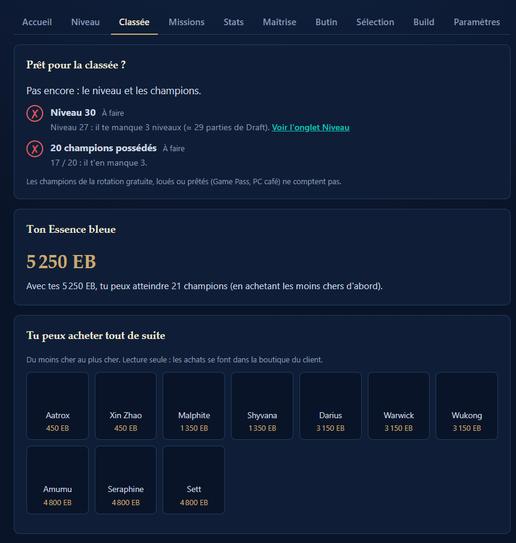

### Missions
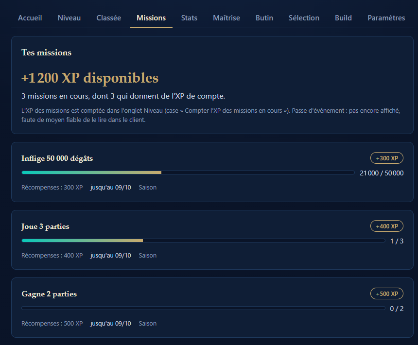

### Stats
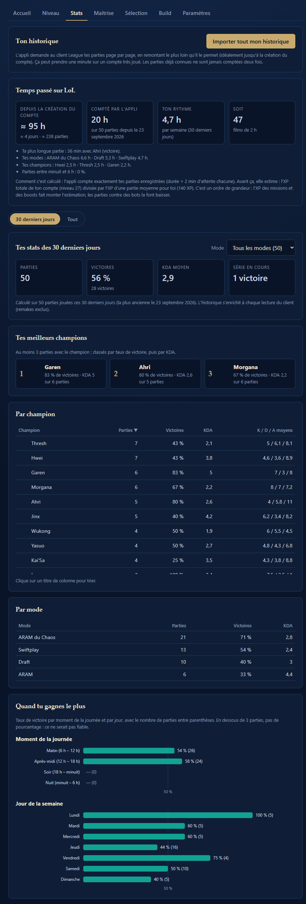

### Maîtrise
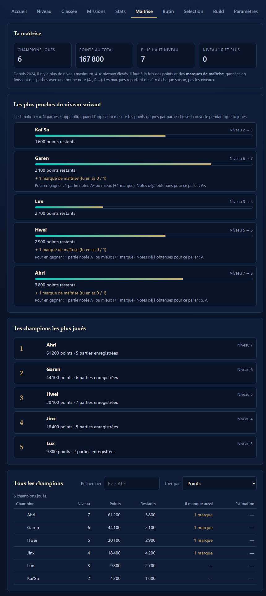

### Sélection
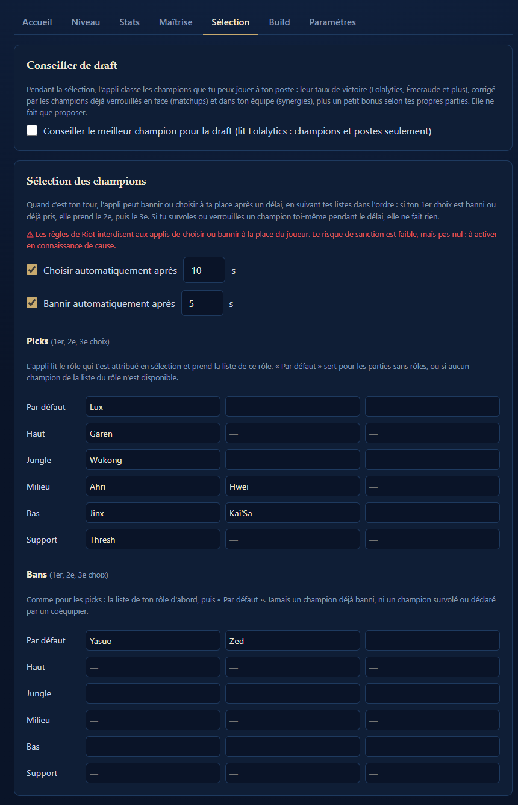

### Build
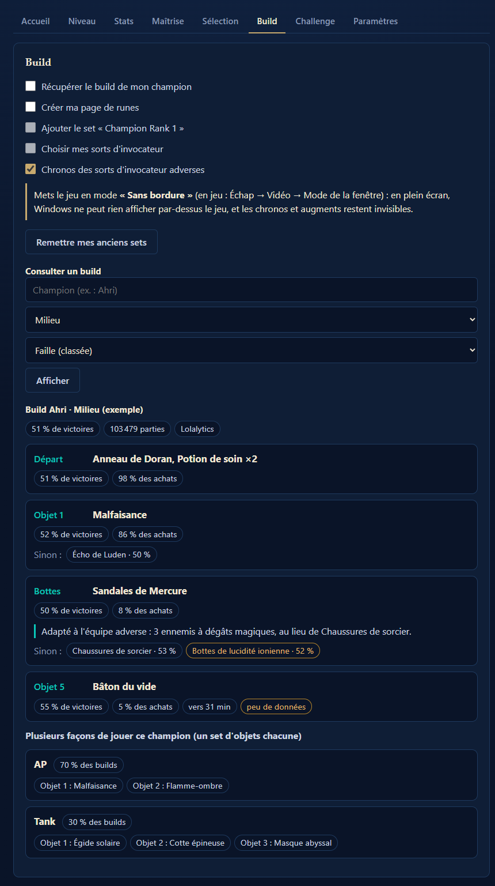

### Augments en jeu (ARAM Mayhem)
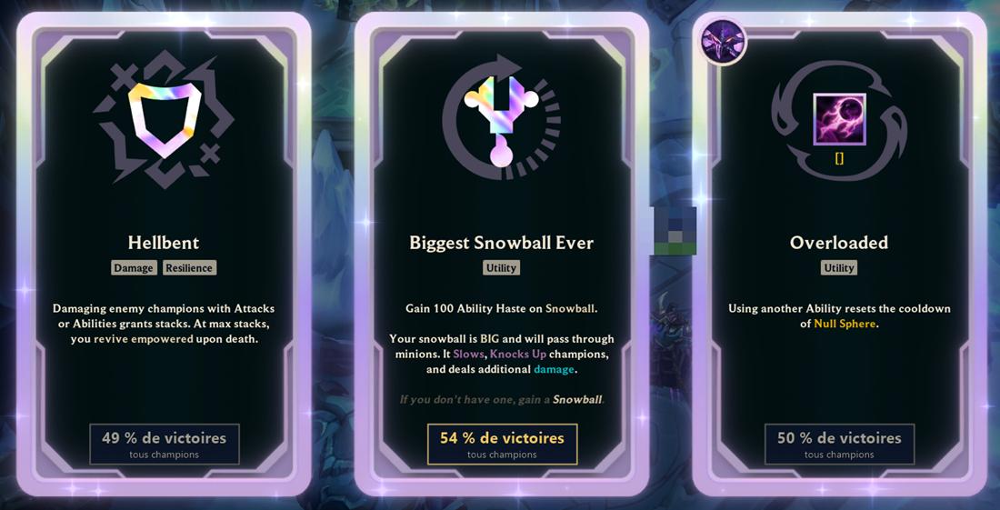

### Paramètres
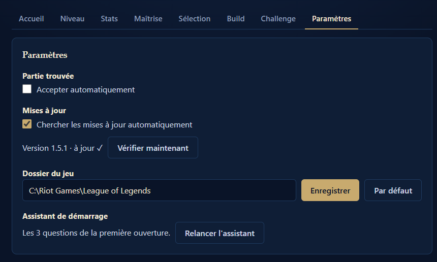

### Petite fenêtre (420 px de large)
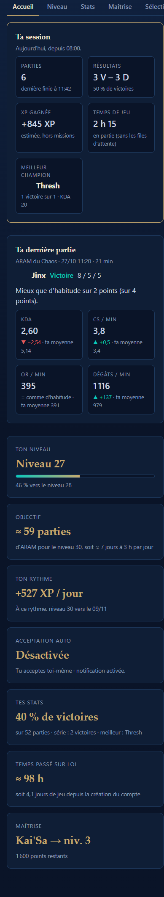

</details>

L'onglet **Butin** (désenchanter les fragments sans risque, avec ta validation) est prévu mais pas encore fait.

## Fonctionnalités

**Tout vient du client, sans bouton.** Dès que le client est détecté (au lancement de l'appli ou quand tu ouvres League),
l'appli lit ton Riot ID, ton niveau et ta progression : il n'y a rien à taper ni à cliquer.
Elle écoute ensuite le client en direct et se met à jour toute seule après chaque partie (« +115 XP environ »).
Client fermé, elle affiche ton dernier compte enregistré (« Données du 30/09 à 18:05 »).

- **Bilan de session** (Accueil) : parties, victoires / défaites, XP gagnée (estimée, hors missions), temps de jeu et
  meilleur champion de la session. La session commence à ta première partie du jour (une soirée sans vraie pause
  continue après minuit) ou à l'ouverture de l'appli, au choix. **Alertes douces** : « 3 défaites d'affilée. Une pause
  de 10 minutes ? » (nombre réglable, désactivable, remakes ignorés) et, si tu l'actives, « Tu joues depuis 2 h ».
  Un simple « OK » pour fermer : jamais de blocage, jamais de reproche. Notification Windows seulement si tu la coches
- **Niveau** : niveau visé (30 proposé pour la classée, sinon le prochain palier de 25) et temps de jeu par jour.
  Calcul pour ARAM du Chaos, ARAM, Swiftplay et Draft avec **ta** durée moyenne et **ton** taux de victoire (valeurs
  moyennes si tu n'as pas assez de parties), le mode le plus rapide mis en avant, 5 min d'attente comptées par partie,
  boosts d'XP, XP des missions en cours (option). Courbe de ton XP dans le temps, rythme réel sur 7 jours et date
  estimée. Fonctionne au-delà du niveau 50
- **Classée** : champions vraiment possédés (rotation gratuite, location et prêts exclus), Essence bleue, nombre de
  champions atteignables, liste des champions achetables du moins cher au plus cher. Lecture seule : l'appli n'achète rien
- **Missions** : missions en cours (progression, récompenses, date de fin), celles qui donnent de l'XP de compte en
  premier. Les missions terminées ne sont ni affichées ni comptées
- **Stats** : par champion (tableau triable) et par mode, 3 meilleurs champions, taux de victoire selon le moment de
  la journée et le jour de la semaine, série en cours. Périodes **30 derniers jours** et **Tout**. Les parties sont
  gardées sur ton PC, et **« Importer tout mon historique »** remonte l'historique du client aussi loin qu'il le permet
- **Maîtrise** : points restants et **marques de maîtrise** manquantes (système de 2024), avec la note à obtenir pour
  en gagner. Estimation « ≈ N parties » à partir de ta moyenne de points par partie sur ce champion, mesurée par
  l'appli après tes parties. Recherche et tri (par points ou par proximité du niveau suivant)
- **Acceptation automatique** de la partie trouvée (désactivée par défaut) : après un délai réglable, jamais si tu as
  déjà répondu, jamais deux fois la même. Notification « Partie trouvée ! » si League n'est pas au premier plan
- **Conseiller de draft** (onglet Sélection, désactivé par défaut, comme iTero.gg en plus simple) : pendant la
  sélection, l'appli classe **les champions que tu peux jouer** à ton poste et affiche les 5 meilleurs, mis à jour à
  chaque champion verrouillé : « Nasus 57,6 % · +3,1 contre Zed · +2,1 contre Yasuo · +0,7 avec Lee Sin ». Le score
  part du taux de victoire du champion à ton poste (Lolalytics, Émeraude et plus), corrigé par chaque **adversaire**
  verrouillé (matchup) et chaque **allié** verrouillé (synergie), plus un petit bonus selon **tes** parties sur ce
  champion (± 2 points au plus). Jamais un champion banni ou déjà pris. Il ne fait que proposer, il ne choisit jamais
- **Pick et ban automatiques** (onglet Sélection, désactivés par défaut, ⚠ contraires aux règles de Riot : voir
  Sécurité). Quand c'est **ton** tour, l'appli verrouille ton champion après **10 s** (ban : **5 s**), réglables.
  3 choix dans l'ordre : si le 1er est banni ou déjà pris, elle prend le 2e, puis le 3e. Une liste par rôle (Haut,
  Jungle, Milieu, Bas, Support), **pour les picks comme pour les bans**, choisie d'après le rôle attribué en sélection,
  plus une liste « Par défaut » (partie sans rôles, ou liste du rôle vide ou indisponible). Jamais un champion banni, déjà pris, survolé ou déclaré par un
  coéquipier. Si tu survoles ou verrouilles un champion toi-même pendant le délai, elle ne fait rien
- **Build** (onglet Build, chaque option désactivée par défaut, autorisé par Riot comme Blitz ou Porofessor) : quand ton
  champion est verrouillé (ou attribué en ARAM), l'appli lit les **vraies statistiques** de **Lolalytics** (objets
  emplacement par emplacement) et d'**OP.GG** (runes, sorts) pour ce champion, ton rôle et le mode (classée/normale et
  outil d'entraînement avec les stats de classée, ARAM, URF), puis :
  - compose le build comme Lolalytics : **Départ, Objet 1, Bottes, Objets 2 à 5**, chacun avec **3 choix** (le
    recommandé + 2 pour t'adapter en partie) ; chaque choix affiche son taux de victoire, sa part des achats, son
    nombre de parties et la minute d'achat (« ⚠ peu de données » sous 200 parties). Si Lolalytics ne répond pas,
    le build d'OP.GG prend le relais (objets principaux, bottes, 4e à 6e objet) ;
  - crée la page de runes « Hwei · Mid · LoL Companion » (champion et poste ; runes d'OP.GG, ou celles **recommandées
    par Riot** si OP.GG ne répond pas ou si les stats sont désactivées). Si le client refuse ou coupe ce nom (la
    longueur maximale n'est documentée nulle part), l'appli essaie « Hwei · Mid · LoLC », puis « LoL Companion » ;
  - choisit tes **sorts d'invocateur** (case séparée) : les plus joués d'après OP.GG, en gardant chaque sort sur ta
    touche habituelle (si Flash est sur F, il y reste). Route du client : `PATCH /lol-champ-select/v1/session/my-selection` ;
  - crée le set d'objets « LoL Companion - Champion (Rôle) », visible dans la boutique en jeu : un bloc par
    emplacement avec ses 3 choix, le recommandé en premier.
  Tes pages de runes et tes sets (Porofessor...) ne sont jamais modifiés. Tu peux aussi consulter le build de
  n'importe quel champion, rôle et mode, sans rien appliquer
- **Augments ARAM Mayhem en jeu** (onglet Build, désactivé par défaut) : quand les 3 augments sont proposés, l'appli
  affiche **sous chaque carte, directement sur l'écran du jeu**, son **taux de victoire** (arammayhem.com) : avec **ton
  champion** si l'augment fait partie de ses meilleurs (« 58 % de victoires · avec ton champion · pris 23 % »), sinon
  tous champions confondus. La carte au meilleur taux est mise en avant (cadre doré), comme le font Porofessor ou
  Blitz, sauf égalité (moins de 1 point d'écart) ou augment trop rare (moins de 3 %). Le jeu doit être en mode
  **« Sans bordure »**. L'appli ne choisit jamais à ta place ([aperçu](docs/captures/apercu-augments.png))
- **Alerte avant les objectifs** (onglet Build, désactivée par défaut, Faille de l'invocateur) : un bandeau discret en
  haut à droite du jeu, sous le chrono, **30 s avant la première apparition** des Carapateurs (2:55), du dragon (5:00),
  des Larves du Néant (8:00), du Héraut (15:00) et du Baron (20:00), avec compte à rebours (liseré doré les 10
  dernières secondes) ; il disparaît à l'apparition, et chaque objectif a sa ligne s'il y en a plusieurs. Le chrono
  vient de l'API officielle du jeu, sur ton PC. **En option** (case séparée, ⚠ voir Sécurité) : les réapparitions,
  dragon 5:00 après sa mort (dragon ancestral 6:00 après l'âme), Baron 6:00, inhibiteurs 5:00 (« allié » / « ennemi »)
- **Chronos des sorts d'invocateur adverses** (onglet Build, désactivé par défaut, ⚠ voir Sécurité) : un petit panneau
  en haut à gauche du jeu avec les 5 adversaires (icône du champion) et leurs 2 sorts. Quand tu vois un adversaire
  utiliser un sort, **tu cliques dessus** : le compte à rebours démarre (bottes de lucidité visibles comptées, TP
  déchaînée après 10:00) ; un 2e clic l'annule. Le reste de l'écran laisse passer les clics au jeu. Mode « Sans bordure » requis
- **Arrière-plan** : une icône dans la zone de notification de Windows (Ouvrir, Acceptation auto à cocher, Quitter).
  La croix **cache** la fenêtre au lieu de quitter (réglable) : la surveillance continue (acceptation auto,
  notifications, mise à jour après chaque partie), et la première fois une notification l'explique. Option
  « Lancer au démarrage de Windows » (désactivée par défaut), éventuellement « réduit » : l'appli tourne alors cachée
  et se connecte toute seule dès que League s'ouvre. Notification **« LoL Companion est prêt »** quand League est
  détecté (avec ce qui est actif : acceptation, pick/ban, build), seulement si la fenêtre est cachée, une fois par
  lancement de League, désactivable. Une seule instance à la fois : relancer l'appli réaffiche la fenêtre déjà ouverte

## Installation

Il faut [Node.js](https://nodejs.org) (version 22 ou plus) et League of Legends installé sur le même PC.

```bash
git clone https://github.com/mohamed-ali-akir/lol-companion.git
cd lol-companion
npm install
npm start
```

Lance le client League et connecte-toi : l'appli récupère tout automatiquement. La toute première fois, le client doit
être lancé (l'appli ne devine pas ton niveau). Le jeu est installé ailleurs que `C:\Riot Games\League of Legends` ?
Change le dossier dans **Paramètres**.

**Au quotidien, utilise l'appli installée** : `npm run build` crée `dist\LoL Companion Setup 1.0.0.exe` ; une fois
installée (dans `%LOCALAPPDATA%\Programs\lol-level-calculator`), c'est **elle seule** qui se lance au démarrage de
Windows. Lancée depuis le projet (`npm start`, VS Code), l'appli ne s'inscrit jamais au démarrage de Windows (sinon
deux versions se lançaient en même temps, et une ancienne pouvait prendre la place de la nouvelle) ; et si Windows la
relance quand même toute seule (`--reduit`, par exemple en rouvrant les applis après un redémarrage), elle s'arrête
aussitôt pour laisser la place à l'appli installée. Pour tester une
modification avec `npm start`, quitte d'abord l'appli installée (clic droit sur l'icône → Quitter) : une seule copie
tourne à la fois. Les deux partagent les mêmes réglages (`%APPDATA%\lol-level-calculator`).

**Dépannage (Windows)** : si `npm start` dit qu'Electron n'est pas installé correctement après `npm install`, lance
`.\reparer-electron.ps1` dans PowerShell. Il décompresse Electron avec l'outil `tar` de Windows (contourne un bug de
décompression rencontré avec certaines versions récentes de Node.js), puis relance les tests.

| Commande | Rôle |
|---|---|
| `npm start` | Lance l'appli |
| `npm test` | Lance les tests (356) |
| `npm run build` | Crée l'installateur dans `dist/` |

## Technologies

- **Electron** : l'interface web devient une appli de bureau
- **HTML / CSS / JavaScript** sans framework ; graphiques en **SVG dessinés à la main**
- **ws** : connexion WebSocket au client League (seule dépendance de l'appli)
- **node:test** : tests intégrés à Node.js, avec un faux client League (HTTPS + WebSocket) sur `127.0.0.1`
- **electron-builder** : installateur

## Comment l'appli parle au client League

Quand il est lancé, le client League ouvre une API sur ton propre PC (le « LCU »). Il écrit le port et un mot de passe
temporaire dans le fichier `lockfile` de son dossier d'installation. L'appli lit ce fichier, puis appelle
`https://127.0.0.1:<port>` avec l'utilisateur `riot` et ce mot de passe. C'est la même technique que Blitz ou Porofessor.

| Route | Utilisée pour |
|---|---|
| `GET /lol-summoner/v1/current-summoner` | Riot ID, niveau, progression |
| `GET /lol-match-history/v1/products/lol/current-summoner/matches?begIndex&endIndex` | Parties : durée, victoire, mode, champion, K/D/A (pages de 50 pour l'import) |
| `GET /lol-champions/v1/owned-champions-minimal` | Champions possédés (`ownership`) |
| `GET /lol-game-data/assets/v1/champion-summary.json` | Noms des champions |
| `GET /lol-game-data/assets/v1/champion-icons/<id>.png` | Icônes des champions |
| `GET /lol-inventory/v1/wallet` (secours : butin `CURRENCY_champion`) | Essence bleue |
| `GET /lol-catalog/v1/items/CHAMPION` (secours : `/lol-store/v1/catalog`) | Prix en Essence bleue |
| `GET /lol-missions/v1/missions` | Missions |
| `GET /lol-champion-mastery/v1/local-player/champion-mastery` (secours : `/lol-champion-mastery/v1/<puuid>/champion-mastery`) | Maîtrise |
| `POST /lol-matchmaking/v1/ready-check/accept` | Accepter la partie (modifie le client, désactivé par défaut) |
| `GET /lol-champ-select/v1/pickable-champion-ids`, `.../bannable-champion-ids` | Champions que le client te laisse choisir / bannir |
| `PATCH /lol-champ-select/v1/session/actions/<id>` `{ championId, completed: true }` (secours : `POST .../actions/<id>/complete`) | Choisir et verrouiller (pick et ban auto : modifie le client, désactivé par défaut), puis relecture de `GET /lol-champ-select/v1/session` pour vérifier le verrouillage |
| `GET /lol-perks/v1/recommended-pages/champion/<id>/position/<rôle ou none>/map/<11 ou 12>` | Runes recommandées par Riot (3 pages ; vérifié sur le client) |
| `GET /lol-gameflow/v1/session` | Carte et mode de la partie (Faille / Abîme hurlant, classée / ARAM / URF) pour le build |
| `GET /lol-perks/v1/pages`, `GET /lol-perks/v1/inventory` | Tes pages de runes, place disponible |
| `POST /lol-perks/v1/pages`, `DELETE /lol-perks/v1/pages/<id>` | Créer / remplacer la page « LoL Companion » (modifie le client, désactivé par défaut ; jamais tes autres pages) |
| `GET` / `PUT /lol-item-sets/v1/item-sets/<summonerId>/sets` | Sets d'objets : on ajoute / remplace « LoL Companion - Champion », tes autres sets sont renvoyés tels quels (modifie le client, désactivé par défaut) |

**Seules connexions à Internet : les statistiques de builds (OP.GG et Lolalytics).** Le client ne fournit aucune
statistique d'objets (`recommendedItemDefaults` est vide). Si tu coches « Récupérer le build de mon champion »
(onglet Build), l'appli envoie **seulement** le champion, le rôle et le mode (jamais ton Riot ID), avec les
certificats vérifiés normalement et les réponses gardées 3 h en mémoire :
- `opgg.js` interroge le serveur public qu'OP.GG met à disposition des applis
  ([OP.GG MCP Server](https://github.com/opgginc/opgg-mcp)) : `POST https://mcp-api.op.gg/mcp`, outil
  `lol_get_champion_analysis` (runes, sorts, et objets si Lolalytics ne répond pas). Il ne donne qu'une combinaison
  pour les objets 1 à 3 et une paire de bottes ;
- `lolalytics.js` lit la page publique du build : `GET https://lolalytics.com/lol/<champion>/build/?lane=<voie>`
  (ARAM / URF : `/aram/build/?tier=all`). C'est la seule source trouvée avec les objets **emplacement par emplacement**
  (recherche du 02/10/2026 : u.gg et dpm.lol n'ont pas d'accès prévu pour les applis non plus). Lolalytics n'a pas
  d'API pour ces données : l'appli lit la page comme un navigateur, en se présentant honnêtement
  (`User-Agent: LoLCompanion/1.0`), et au plus une fois par champion / voie / mode toutes les 3 h. Son `robots.txt`
  n'interdit rien et aucune condition d'utilisation trouvée ne vise l'accès automatique. Si le site change, l'appli
  revient au build d'OP.GG et le signale.
- le **conseiller de draft** (case de l'onglet Sélection) lit aussi Lolalytics, avec les mêmes règles :
  la tier list de ton poste (`/lol/tierlist/?lane=<voie>` : taux de victoire et parties de chaque champion), la page
  de chaque adversaire verrouillé (son tableau `enemy` : ses matchups par voie) et, pour chaque allié verrouillé,
  `GET https://a1.lolalytics.com/mega/?ep=build-team&patch=<patch>&c=<champion>&lane=<voie>…` (ses synergies).
  Seuls des noms de champions, de postes et le patch sont envoyés ; aucun pseudo n'est lu.

En plus, l'appli s'abonne en **WebSocket** (`wss://127.0.0.1:<port>/`, protocole WAMP) aux événements du client :
phase de jeu (`EndOfGame` = une partie vient de finir), compte, champions possédés, portefeuille, missions,
« partie trouvée » (ready-check) et sélection des champions (`lol-champ-select/v1/session` : actions, rôle attribué,
bans, temps restant du tour). Plusieurs événements rapprochés ne déclenchent qu'une relecture ; client fermé,
l'appli réessaie toutes les 5 secondes et se reconnecte toute seule.

Les formats ont été vérifiés dans le schéma publié par la communauté
([lcu-schema](https://github.com/MingweiSamuel/lcu-schema)) et, pour la maîtrise (refonte de 2024), dans les types du
projet LeagueAkari et la doc `champion-mastery-v4` de Riot. Chaque lecture est **tolérante** : un champ manquant ou
inattendu n'est jamais une raison de planter, l'appli affiche ce qu'elle a.

### Quelques choix techniques

- **Icônes** : le client demande son mot de passe même pour les images. La page affiche ``,
  un protocole maison géré par `main.js` qui va chercher l'image et la garde en cache. Seules les icônes de champions
  passent : la page ne peut pas s'en servir pour appeler une autre route.
- **Import de l'historique** : pages de 50 parties ; arrêt quand la page est vide, quand elle ne contient que des
  parties déjà vues (certains clients renvoient toujours la dernière page) ou après 400 pages. Enregistrement toutes
  les 10 pages : rien n'est perdu si le client se ferme pendant l'import.
- **Estimation de maîtrise** : le client ne dit pas combien de points chaque partie a rapportés. À chaque lecture,
  l'appli compare les points d'un champion avec la lecture précédente et compte les nouvelles parties jouées avec lui
  (« +1 800 points en 2 parties »). Si le client a mis à jour l'un mais pas encore l'autre, elle attend la lecture suivante.
- **Session** : « aujourd'hui » = parties depuis minuit, plus celles de la veille si tu jouais sans pause de plus de
  45 min au moment de minuit. Alertes seulement si ta dernière partie date de moins de 45 min (sinon tu as déjà fait
  une pause), une seule notification par série de défaites.
- **Acceptation automatique** : le ready-check n'a pas d'identifiant, un nouveau commence quand l'état passe à
  « `InProgress` + `playerResponse: None` » (en attente de ta réponse) depuis **n'importe quel** autre état, y compris
  « `InProgress` + `Accepted` » : quand un autre joueur refuse, le client peut enchaîner directement sur la partie
  suivante sans état intermédiaire (auparavant cette nouvelle partie était prise pour l'ancienne et jamais acceptée).
  Les mises à jour du même ready-check (le timer avance) ne déclenchent rien de plus ; `Accepted` ou `Declined`
  annule toujours une acceptation prévue. Juste avant d'accepter, l'appli revérifie tout (même partie, toujours en cours, pas encore de réponse,
  réglage toujours activé). Pour savoir si League est au premier plan, une petite commande PowerShell lit la fenêtre
  active ; en cas de doute, la notification est affichée.
- **Pick et ban automatiques** (`selection.js`) : à chaque changement de la sélection, l'appli cherche **ton** action
  en cours (`actorCellId` = `localPlayerCellId`, `isInProgress`, pas `completed`) et la prend en charge une seule fois
  (oubli à la fin de la sélection ou quand `gameId` change). Si le délai dépasse le temps restant du tour
  (`timer.adjustedTimeLeftInPhase`), elle agit 2 s avant la fin. Juste avant d'agir, elle revérifie tout (même action,
  toujours en cours, pas de champion survolé par toi, option toujours activée), avant ET après avoir lu les champions
  autorisés par le client. Vu sur le vrai client : pendant la phase de préparation (`PLANNING`), ton ban est déjà
  marqué « en cours » mais le client ignore un ban envoyé à ce moment-là, donc l'appli attend la phase `BAN_PICK`.
  Le client a aussi répondu « OK » à un verrouillage sans verrouiller : l'appli relit donc la session pour vérifier,
  essaie l'autre méthode si besoin, et sinon affiche une erreur au lieu d'un faux « OK ».
- **Conseiller de draft** (`draft.js`) : pour chaque champion C que tu peux choisir (`pickable-champion-ids` :
  possédés + rotation gratuite), score = taux de victoire de C à ton poste + Σ effets des champions **verrouillés**
  (un survol ne compte pas, il peut changer) + confort. L'effet d'un duo est le « delta 2 » de Lolalytics : l'écart
  du duo par rapport à ce qu'on attendrait des deux champions seuls (contre un adversaire, on prend l'opposé de son
  delta, puisqu'il est vu de son côté). Prudence : chaque effet est multiplié par n / (n + 1 000) (n = parties du
  duo), et le taux de base est ramené vers 50 % par n / (n + 5 000), sinon un champion joué par quelques spécialistes
  passe devant (Fiddlesticks milieu : 1 670 parties à 54 %, devant Ahri à 52,5 % sur 199 182 parties). Les champions
  à moins de 1 000 parties à ce poste ne sont pas proposés. Confort : ton taux de victoire sur le champion, lissé
  par 5 victoires + 5 défaites fictives, + 0,05 point par partie jouée (20 au plus), borné à ± 2 points. Recalcul
  seulement quand la draft change (nouveau pick, ban) ; un calcul plus ancien et plus lent n'écrase jamais le
  nouveau. Si les données d'un adversaire manquent, il n'est pas compté et l'appli le dit.
- **Alerte des objectifs** (`objectifs.js`) : pendant une partie sur la Faille (carte 11 dans
  `/lol-gameflow/v1/session`), l'appli lit le chrono toutes les secondes avec l'API officielle « Live Client Data »
  que le jeu ouvre sur ton PC (`GET https://127.0.0.1:2999/liveclientdata/allgamedata` → `gameData.gameTime`,
  `allPlayers` et `events`, sans mot de passe ; certificat de Riot accepté seulement pour cet appel, comme pour le
  client). Le bandeau ne change que quand son texte change. Réapparitions : l'appli relit les événements `DragonKill`
  et `BaronKill` (annoncés à tous les joueurs, les deux équipes comprises) ; l'équipe du tueur, retrouvée par son nom
  dans `allPlayers`, sert à savoir quand une équipe a 4 dragons (l'âme : ensuite, dragons ancestraux à 6:00). Si un
  nom est introuvable, 7 dragons tués suffisent à savoir que l'âme est prise. Inhibiteurs : événement `InhibKilled`
  (`Barracks_T2_C1` = inhibiteur du milieu de l'équipe 2). Plus d'Atakhan ni de chute des plaques à 14:00 en 2026.
- **Chronos des sorts** (`sorts.js`) : temps de recharge vérifiés le 10/10/2026 (Flash 300 s, Ignite 180, TP 300 puis
  330 → 240 selon le niveau après 10:00, Heal/Exhaust/Ghost/Cleanse 240, Barrière 180) ; accélération : Bottes
  ioniennes de lucidité +10, Lucidité pourpre +20 (la rune Perspicacité cosmique est invisible pour l'adversaire,
  donc pas comptée) ; temps = base / (1 + accélération / 100). Le temps de jeu entre deux lectures est estimé avec
  l'horloge du PC, pour qu'un clic tombe à la bonne seconde. La fenêtre transparente laisse passer les clics
  (`setIgnoreMouseEvents(true, { forward: true })`) et ne les prend que quand la souris est sur le panneau ; elle ne
  prend jamais le clavier au jeu (`focusable: false`). Heures d'apparition vérifiées le 10/10/2026 sur le wiki officiel (patch 26.x) ; Riot les change parfois
  d'une saison à l'autre. Le bandeau partage la fenêtre transparente des augments, cachée quand il n'y a rien.
- **Build** (`build.js`, `lolalytics.js`, `opgg.js`, `runes.js`) : l'appli attend que ton pick soit verrouillé
  (`completed`) ; en ARAM, où il n'y a pas d'action « pick », le champion attribué suffit, et une relance de champion
  refait tout. Une seule fois par champion et par sélection. Sans rôle attribué, elle prend le rôle principal du
  champion d'après les runes recommandées par Riot. Lolalytics et OP.GG sont lus en parallèle (quelques secondes).
  - **3 choix par emplacement (Lolalytics)** : pour chaque emplacement, les options **fiables** (au moins 10 % des
    achats de cet emplacement **et** 200 parties) passent d'abord, puis celles à au moins 2 % et 200 parties, puis le
    reste ; dans chaque groupe, classement par **borne basse de Wilson** à 95 % (voir ci-dessous). Un objet recommandé
    à un emplacement n'est plus proposé ensuite. Lolalytics donne un % de sélection sur TOUTES les parties, qui
    baisse forcément pour les derniers objets : l'appli le ramène à la part des achats de l'emplacement. L'avertissement
    « peu de données » ne dépend que du nombre de parties (aux derniers emplacements, les achats sont trop variés
    pour qu'un objet atteigne 10 %). En ARAM/URF, tous les rangs sont pris (Hwei : 48 019 parties au lieu de 3 460
    en Émeraude+). Attention aux objets « boule de neige » comme le Voleur d'âmes de Mejai : achetés quand on gagne
    déjà, leur taux de victoire est gonflé.
  - **Format de Lolalytics** : la page contient ses données dans un bloc `<script type="qwik/json">` ; les valeurs
    renvoient à d'autres cases par un numéro en base 36 (`"4c6"` → case 5622). Chaque option d'objet vaut
    `[objet, % victoire, % sélection, parties, minute]`, chaque départ `["1056_2003_2003", % victoire, % sélection, parties]`.
    Noms : alias du client en minuscules, sauf `MonkeyKing` → `wukong`. Testé avec une fausse page au même format.
  - **Classement « taux de victoire + taux de sélection » (OP.GG, en secours)** : pour le 4e, 5e et 6e objet, OP.GG propose 3 options
    (pour les objets 1 à 3, il ne donne qu'une combinaison : vérifié). Une option n'est retenue que si elle est
    **fiable** : prise dans au moins **10 %** des parties **et** sur au moins **200** parties. On classe ensuite par
    **borne basse de Wilson** à 95 % (un taux de victoire « prudent » : marge d'autant plus grande qu'il y a peu de
    parties). Exemple : 59 % sur 9 000 parties passe devant 62 % sur 24 parties. Si aucune option d'un emplacement
    n'est fiable (souvent le 6e : pour Hwei, 5, 4 et 4 parties), on prend le meilleur objet fiable restant parmi les
    options des emplacements précédents. Un objet déjà dans le build n'est jamais reproposé. Les 2 autres choix de
    chaque emplacement sont affichés (« Pour t'adapter ») et regroupés dans un bloc du set d'objets en jeu.
  - **Format d'OP.GG** : la réponse n'est pas du JSON mais un texte (`class Nom: champ1,champ2` puis
    `Nom(valeur1, valeur2)`), lu par un petit analyseur testé (`analyserTexteOpgg`). Vérifié en direct : `position`
    est obligatoire et `all` / `none` sont refusés, donc en ARAM on envoie `mid` (les stats ARAM ne dépendent pas
    du rôle) ; les noms sont tolérants (`MONKEYKING`, `MONKEY_KING` et `WUKONG` marchent).
  - **Runes** : la page « LoL Companion » est supprimée puis recréée (plus simple et plus fiable qu'une
    modification) ; les pages qui ont un autre nom ne sont jamais touchées.
  - **Set d'objets** : le `PUT` du client remplace TOUTE la liste des sets ; l'appli renvoie donc tes sets exactement
    comme elle les a lus et ne remplace que le set « LoL Companion » du même champion.
- **Augments ARAM Mayhem** (`augments.js`, `ocr.js`, fenêtre `src/overlay.html`) : Riot ne dit pas quels augments te
  sont proposés (ni le client, ni l'API du jeu ; seul Overwolf le fournit). Comme ezlol ou aram-mayhem-tracker, l'appli
  lit donc leurs noms à l'écran, seulement pendant une partie ARAM Mayhem (file 2400, détectée par la phase
  `InProgress` du client) et si la case est cochée :
  - une fois par seconde, capture de la **bande des titres** (36 % à 47 % de la hauteur de l'écran), lue par l'**OCR
    de Windows** (`Windows.Media.Ocr`) via un seul processus PowerShell resté ouvert (script passé en `-EncodedCommand`,
    aucun fichier à installer, aucune dépendance) : 10 à 95 ms par lecture, mesuré sur des captures en 2560x1440 ;
  - on ne garde que les textes qui sont de **vrais noms d'augments** (liste complète du client :
    `/lol-game-data/assets/v1/cherry-augments.json`, dans la langue du jeu), alignés à la même hauteur ; une erreur
    d'une lettre sur huit est tolérée (distance d'édition) ; il faut au moins 2 cartes reconnues ;
  - stats : **arammayhem.com** (`arammayhem.js`) : page de ton champion (retenu pendant la sélection) avec ses 6
    meilleurs augments par rareté (taux d'apparition et de victoire avec lui), et page de tous les augments (taux tous
    champions) en secours. Mise en avant : meilleur taux parmi les augments du top de ton champion, sinon parmi les
    taux tous champions ; jamais sous 3 % d'apparition ni en cas de quasi-égalité (moins de 1 point). Choix fait le
    02/10/2026 après comparaison : l'outil d'OP.GG (`lol_list_aram_augments`) ne donnait qu'une « popularité » sans taux
    de victoire (total de plus de 360 % pour Hwei : pas un vrai taux de sélection), et la carte « la plus prise » était
    rarement la bonne ; League of Graphs (source de Porofessor) refuse les accès automatiques. Pas d'API : pages
    publiques (robots.txt « Allow: / »), User-Agent honnête, cache 3 h. Noms en anglais : jeu en anglais requis ;
  - affichage : fenêtre transparente toujours au premier plan, qui **laisse passer les clics** (`setIgnoreMouseEvents`)
    et ne prend jamais la main au jeu (`focusable: false`, `showInactive`), avec son propre pont (`preload-overlay.js`,
    une seule fonction) ; étiquette à 19 % de la hauteur de l'écran sous le titre, dans le bas vide de la carte.
    Elle se cache après 2 lectures sans cartes (tu as choisi). En plein écran exclusif, Windows ne peut rien afficher
    par-dessus le jeu : mode « Sans bordure » obligatoire.
- **Deux canaux vers le client** (`sondage.js`) : la connexion en direct (WebSocket, `surveillance.js`) s'établissait
  parfois très tard après un redémarrage du PC (vu le 02/10/2026 : appli lancée à 20:12, League à 20:13, connexion
  plusieurs minutes après), et l'acceptation automatique ne voyait pas la partie trouvée. Maintenant, en plus,
  l'appli **interroge elle-même le client toutes les secondes** (phase de jeu ; ready-check en file ; session en
  sélection des champions) et donne les réponses à la même logique (acceptation, pick/ban, build). Une réponse en
  retard d'un canal (« None » juste après « Accepted ») est reconnue grâce au timer du client, qui repart de 0 à
  chaque nouvelle partie trouvée : jamais de double acceptation ni de double notification (testé).
  **Chien de garde** : si le client répond mais que la connexion en direct est absente, ou n'a pas transmis le dernier
  changement de phase, depuis plus de 15 s, elle est refaite (`reconnecter()`). La vérification « client prêt » a un
  temps limite (8 s) pour ne jamais bloquer les tentatives.
  **Vieux lockfile** : après un plantage ou un arrêt du PC, League peut laisser son `lockfile` ; l'appli vérifie que le
  processus dont le numéro y est écrit existe encore (`process.kill(pid, 0)`, qui n'arrête rien), sinon League est
  considéré comme fermé (vu le 04/10/2026 : « League démarre… » restait affiché alors que League était fermé).
  **Bandeau** en haut de la fenêtre tant que l'appli n'est pas prête (« League démarre… », « Connexion à League en
  cours… (l'acceptation automatique fonctionne déjà) ») ; il disparaît tout seul dès qu'elle est prête.
  **Journal** (`journal.js`) : `%APPDATA%\lol-level-calculator\journal.txt` (200 Ko au plus, puis `journal.ancien.txt`)
  note les connexions, l'état du client, les parties trouvées, les acceptations et les erreurs rattrapées. Rien de
  personnel (ni mot de passe du client, ni Riot ID).
- **Cloisons de sécurité** : chaque fonctionnalité qui réagit au client (acceptation, pick/ban, build, relectures du
  compte, classée, missions) est appelée dans sa propre bulle (`proteger` dans `surveillance.js` et `main.js`). Si
  l'une plante, l'erreur est écrite dans le terminal (« Erreur dans « pick et ban automatiques » ... ») et les autres
  continuent : une erreur ailleurs ne peut plus empêcher l'acceptation de recevoir « partie trouvée ». Un filet global
  (`uncaughtException`, `unhandledRejection`) écrit aussi dans le terminal les erreurs qui passeraient entre les mailles.
  (Vu le 02/10/2026 : l'appli restait connectée au client mais ne réagissait plus, alors que le même code, lancé hors
  de l'appli, aurait accepté.)
- **Client lancé après l'appli** : abonnée pendant que le client démarrait encore, l'appli ne recevait plus aucun
  événement (ni partie trouvée, ni sélection). Elle attend donc que le client réponde normalement
  (`GET /lol-gameflow/v1/gameflow-phase` en 200) avant d'ouvrir le WebSocket et de s'abonner, et réessaie toutes les
  5 s sinon.
- **Arrière-plan** : les décisions (que fait la croix, quoi donner à `app.setLoginItemSettings`, contenu du menu de
  l'icône) sont des fonctions pures testées (`arriere-plan.js`) ; `main.js` ne fait que les appliquer avec Electron
  (`Tray`, `requestSingleInstanceLock`, `setLoginItemSettings`). « Quitter » arrête la surveillance (WebSocket et
  minuteries), l'acceptation et l'icône : rien ne garde l'appli en mémoire. La croix ne cache la fenêtre que si
  l'icône existe (sinon on ne pourrait plus la rouvrir), et jamais pendant l'arrêt de Windows.
- **Graphiques** : SVG dessinés à la largeur réelle de la fenêtre (les textes restent lisibles sur une petite fenêtre),
  couleurs vérifiées pour être lisibles sur le fond sombre, y compris par les personnes daltoniennes. La courbe a un
  tableau « Voir les données » qui donne les mêmes valeurs en texte.

## Sécurité

- La page n'a pas accès à Node.js (`contextIsolation`, `sandbox`, pas de `nodeIntegration`) : elle passe uniquement
  par les fonctions exposées dans `preload.js`. Une Content-Security-Policy bloque tout script ou contenu extérieur.
- L'appli parle au client League sur `127.0.0.1`. Le certificat auto-signé du client est accepté **seulement** pour
  ces appels (agent HTTPS dédié), jamais pour le reste.
- **Seules connexions à Internet** (décision du propriétaire, 02/10/2026) : les statistiques de builds d'OP.GG et de
  Lolalytics, celles du conseiller de draft (Lolalytics) et des augments (arammayhem.com), chacune seulement si tu
  l'actives (désactivé par défaut). Lecture seule, depuis le processus principal, certificats vérifiés
  normalement, et seuls le champion, le rôle, le mode et la langue sont envoyés : jamais ton Riot ID ni rien de
  personnel. La page web de l'appli, elle, ne se connecte à rien (Content-Security-Policy inchangée).
- Ce qui modifie le client (accepter une partie, pick et ban automatiques, page de runes, set d'objets, sorts
  d'invocateur) est désactivé
  par défaut et ne s'applique qu'au compte connecté.
- Interdit par les règles de Riot, donc absent : révéler les pseudos en sélection des champions, donner une info en
  jeu que les joueurs n'ont pas normalement.
- **Alerte des objectifs** : les premières apparitions sont à heure fixe et connues de tous (un réveil réglé sur le
  chrono du jeu). Les **réapparitions** (option séparée, désactivée par défaut) sont une exception décidée par le
  propriétaire (10/10/2026) : en 2014, Riot a jugé injuste un chrono qui n'existe que dans une appli tierce, même si
  la mort des objectifs est annoncée à tous. Risque jugé faible (lecture de l'API officielle, rien d'injecté, aucun
  cas de sanction connu pour un chrono), mais pas nul.
- **Chronos des sorts adverses** : exception décidée par le propriétaire (10/10/2026), comme Porofessor ou Blitz. C'est
  le joueur qui clique quand il voit un sort utilisé ; l'appli ne fait que compter. Les chronos des **ultimes**
  adverses sont absents : Riot les interdit depuis le 13/03/2025, même manuels.
- **Pick et ban automatiques** : les règles de Riot interdisent aussi de choisir ou bannir à la place du joueur. Le
  propriétaire du projet a choisi de l'ajouter quand même (02/10/2026), en connaissance du risque pour son compte
  (faible mais pas nul). Garde-fous : désactivé par défaut, délai avant d'agir, seulement ton action, et rien si tu
  choisis toi-même.

## Données enregistrées sur ton PC

Tout reste dans `%APPDATA%\lol-level-calculator\` (jamais dans le projet ni dans Git) :

| Fichier | Contenu |
|---|---|
| `journal.txt` | Journal de l'appli : connexions au client, parties trouvées, acceptations, erreurs (200 Ko au plus, puis `journal.ancien.txt`) |
| `config.json` | Dossier du jeu, dernier compte lu, dernier onglet ouvert, réglages de l'acceptation automatique, du conseiller de draft, du pick et du ban automatiques (`selectionAuto` : cases, délais, listes de picks et de bans par rôle), du build (`buildAuto` : stats Lolalytics/OP.GG, runes, set d'objets, sorts d'invocateur, augments, alerte des objectifs et réapparitions, chronos des sorts), de la session et de l'arrière-plan |
| `parties.json` | Tes parties (Stats, session, maîtrise) : `{ riotId, id, date, dureeS, file, championId, championNom, victoire, kills, deaths, assists }`, sans doublons, 25 000 au maximum par compte |
| `progression.json` | Les points de ta courbe : `{ date, riotId, niveau, progression, xpTotale }`, 1 000 au maximum par compte |
| `maitrise.json` | Dernière lecture des points de maîtrise de chaque champion et échantillons « N points en M parties » (30 au maximum par champion) |

Effacer la courbe ou les parties : onglet **Paramètres**. Pour tout effacer, supprime ce dossier.

## Comment fonctionne le calcul d'XP

L'XP d'une partie dépend de sa durée et du résultat (formules du
[wiki League of Legends](https://leagueoflegends.fandom.com/wiki/Experience_(summoner))) : victoire
`0,11 × secondes + 6,6`, défaite `0,09 × secondes + 5,4`, réduite contre les bots selon le niveau, rien sous 7 minutes.
Il faut **39 936 XP** du niveau 1 au niveau 30. L'appli simule les parties une par une, car l'XP contre les bots change
selon le niveau atteint.

## Structure du projet

```
lol-level-calculator/
├── CLAUDE.md          # Règles du projet (sécurité, tests, pas d'Internet...), relues par Claude Code
├── main.js            # Processus principal : fenêtre, messages de la page, surveillance, notifications
├── preload.js         # Pont sécurisé entre la page et main.js (contextBridge)
├── lcu.js             # Lecture du client League (lockfile, API locale, historique, import)
├── surveillance.js    # Écoute du client en direct (WebSocket)
├── stockage.js        # Réglages (config.json)
├── progression.js     # Courbe de progression (progression.json)
├── parties.js         # Historique local des parties (parties.json)
├── classee.js         # Classée : champions possédés, Essence bleue, prix, icônes (protocole lcu-image)
├── missions.js        # Missions : lecture, XP de compte, tri
├── maitrise.js        # Maîtrise : lecture tolérante, mesure des points par partie (maitrise.json)
├── session.js         # Session : quelles alertes de pause notifier (une seule fois chacune)
├── acceptation.js     # Acceptation automatique + détection du premier plan
├── selection.js       # Pick et ban automatiques (rôle, listes, champions disponibles, délais)
├── draft.js           # Conseiller de draft : picks verrouillés, score (matchups, synergies, confort), suivi
├── build.js           # Build : classement des objets, page de runes, set d'objets, logique automatique
├── opgg.js            # Statistiques d'OP.GG (Internet) : runes, sorts, objets en secours ; lecture du format, cache
├── lolalytics.js      # Lolalytics (Internet) : objets emplacement par emplacement, tier list, matchups, synergies ; cache
├── sorts.js           # Chronos des sorts d'invocateur adverses : recharges, accélération, clics du panneau en jeu
├── objectifs.js       # Alerte avant les objectifs en jeu : heures d'apparition, chrono du jeu (API locale), bandeau
├── augments.js        # Augments ARAM Mayhem : reconnaissance des cartes, étiquettes, surveillance pendant la partie
├── ocr.js             # Lecture de texte à l'écran (OCR de Windows, via PowerShell)
├── arammayhem.js      # Taux de victoire des augments ARAM Mayhem (arammayhem.com, Internet) : lecture des pages, cache
├── sondage.js         # Deuxième canal : interroge le client toutes les secondes ; état « prête / pas prête »
├── journal.js         # Journal sur le disque (journal.txt), taille limitée
├── preload-overlay.js # Pont de la fenêtre transparente par-dessus le jeu : augments, objectifs (src/overlay.html)
├── runes.js           # Runes : page « LoL Companion », runes recommandées par Riot (secours)
├── arriere-plan.js    # Arrière-plan : la croix, le démarrage de Windows, le menu de l'icône (fonctions pures)
├── assets/            # Icône de l'appli (icon.ico, icon.png, tray.png) : fenêtre, zone de notification, installateur
├── reparer-electron.ps1 # Dépannage de l'installation d'Electron sous Windows (voir Installation)
├── docs/captures/     # Captures du README
├── docs/prompt-selection-auto.md # Cahier des charges du pick et ban automatiques
├── src/
│   ├── index.html     # Interface : carte "Ton compte", barre d'onglets, un panneau par onglet
│   ├── style.css      # Design
│   ├── calculs.js     # Calculs purs (XP, modes, stats, maîtrise, session) : page, main.js et tests
│   ├── commun.js      # État partagé, petits outils, mettreAJour() qui redessine tous les onglets
│   ├── onglets/       # Un fichier par onglet (+ compte.js pour la carte du compte, session.js pour la session)
│   └── app.js         # Démarrage : branche tout (explique l'ordre de chargement)
└── test/              # Un fichier de tests par module, faux client dans chaque test réseau, certificat de test
```

Les calculs sont des fonctions pures (`src/calculs.js`) séparées du code qui manipule la page : on les teste sans
ouvrir l'appli. Les fichiers de la page sont des scripts classiques chargés dans l'ordre par `index.html`, pour que
`calculs.js` puisse aussi être chargé tel quel par Node (`require`) dans les tests et dans `main.js`. Chaque onglet
s'inscrit avec `surRendu()` et est redessiné par `mettreAJour()`.

## Limites connues

- L'API du client League n'est **pas officielle** : une mise à jour du jeu peut changer une route ou un champ. Les
  routes de maîtrise, le nom exact des récompenses « XP de compte » des missions et les devises des prix n'ont été
  vérifiés que dans la documentation de la communauté, pas sur toutes les versions du client.
- L'import de l'historique ne remonte que ce que le client accepte de donner : pas forcément jusqu'à la création
  du compte.
- L'XP de session et les estimations utilisent les formules du wiki : ce sont des estimations.
- Les données sont rangées par Riot ID (`pseudo#tag`) : si tu changes de Riot ID, l'historique repart de zéro.
- Le code de la page (`src/onglets/`) et la partie Electron de l'arrière-plan (icône, fenêtre cachée, démarrage de
  Windows) n'ont pas de tests automatiques : ils sont vérifiés en lançant l'appli.

## Prochaines étapes

- Onglet **Butin** : désenchanter les fragments en double sans risque, avec validation

---

*Projet non officiel, non affilié à Riot Games.*
